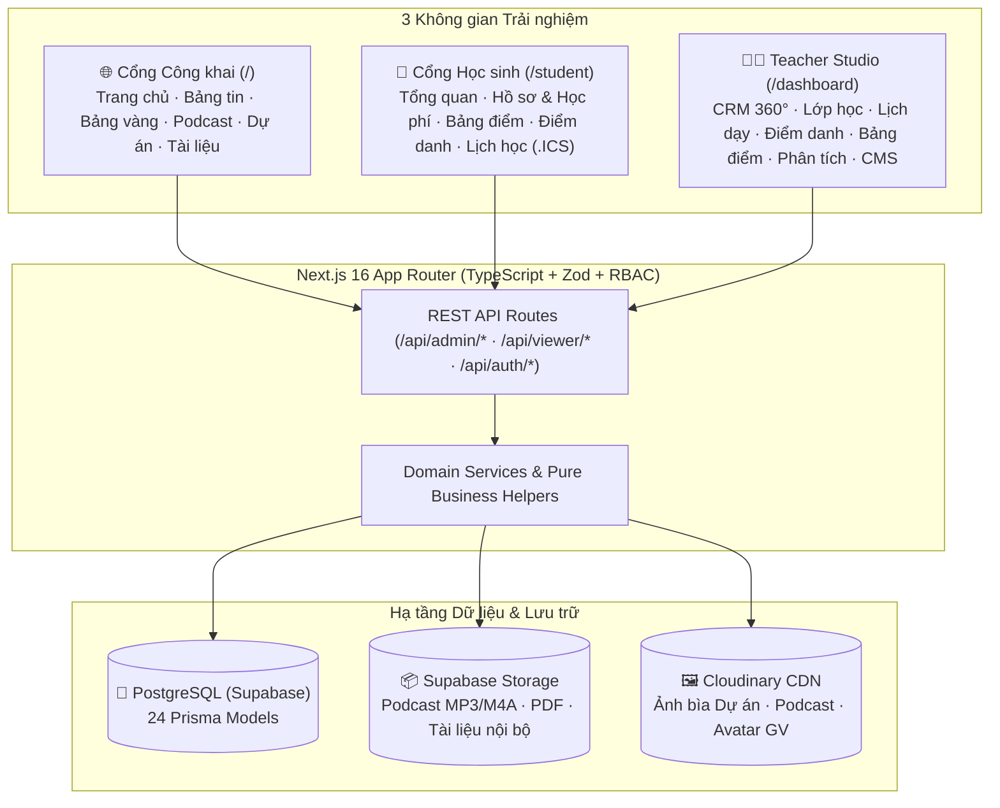

<div align="center">

# 🎓 English Manager — Academic English & Mentorship Platform

**Nền tảng quản trị học vụ toàn diện dành cho Giáo viên Tiếng Anh & IELTS**, tích hợp **Teacher Studio (CRM 360°)**, **Cổng Tra cứu Học sinh (Student Portal)** và **Cổng Thông tin Thương hiệu Công khai (Public Editorial Portal)**.

[](https://nextjs.org/)
[](https://react.dev/)
[](https://www.typescriptlang.org/)
[](https://www.prisma.io/)
[](https://supabase.com/)
[](https://tailwindcss.com/)
[](https://cloudinary.com/)

[Tổng quan](#-tổng-quan--kiến-trúc) · [Tính năng](#-tính-năng-nổi-bật) · [Bảo mật & Lưu trữ](#-bảo-mật--kiến-trúc-lưu-trữ) · [Cài đặt Local](#-cài-đặt--chạy-local) · [Deploy Vercel](#-triển-khai-lên-vercel)

</div>

---

## 🧭 Tổng quan & Kiến trúc

**English Manager** số hóa khép kín toàn bộ quy trình vận hành của một lớp học / học viện Tiếng Anh học thuật: từ tuyển sinh, xếp lớp chống trùng lịch, chấm điểm 4 kỹ năng chuẩn IELTS, theo dõi chuyên cần, quản lý sổ thu học phí, đến xuất bản Podcast học thuật, thư viện tài liệu và thương hiệu cá nhân của giáo viên.



---

## ✨ Tính năng Nổi bật

### 1. Teacher Studio — Bàn làm việc Giáo viên (`/dashboard`, `/students`, `/classes`, ...)

| Phân hệ | Đường dẫn | Nghiệp vụ cốt lõi |
| :--- | :--- | :--- |
| **Tổng quan Học vụ** | `/dashboard` | KPI điều hành thời gian thực, lịch dạy hôm nay, trung tâm cảnh báo ưu tiên kèm mẫu tin nhắn nhắc Zalo 1 chạm. |
| **CRM Học sinh 360°** | `/students` | Quản lý vòng đời học viên (`Đang học`, `Học thử`, `Bảo lưu`, `Lưu trữ`); Hồ sơ 360° (5 tab: Tổng quan, Điểm 4 kỹ năng, Chuyên cần, Sổ học phí & Biên nhận `REC-...`, CRM Phụ huynh & Cấp/Đặt lại mật khẩu Portal); **Nhập/Xuất CSV 16 cột thông minh** xem trước đầy đủ cột; Chuyển lớp & Xuất báo cáo tiến độ hàng loạt. |
| **Lớp học & Giáo trình** | `/classes` | Khởi tạo / Nhân bản khóa mới, **xếp thời khóa biểu chống trùng lịch**, quản trị lộ trình & học liệu theo từng tuần, dời lịch hàng loạt, lưu giáo trình mẫu và cơ chế **lưu trữ lớp an toàn** (chặn lưu trữ khi lớp còn học viên). |
| **Lịch dạy & Điểm danh** | `/schedule`, `/attendance` | Lịch tuần / tháng / ma trận phòng học, xử lý buổi học bù & ngoại lệ; điểm danh nhanh theo ca học kèm tạo thông báo gửi phụ huynh. |
| **Nhật ký Giảng dạy** | `/teaching-journal` | Ghi nhận nội dung bài dạy thực tế, giao & chấm tình trạng BTVN từng học viên, xuất bản tin tổng kết gửi phụ huynh. |
| **Điểm số & Nhận xét** | `/grades` | Chấm điểm 4 kỹ năng chuẩn IELTS (`0.0–9.0`), tự tính Overall & chỉ số tiến bộ (`Delta`), **phạm vi kỳ thi theo lớp hoặc toàn trung tâm**, quy trình kiểm duyệt **Bản nháp (`Draft`) $\leftrightarrow$ Công bố (`Published`)**, tách biệt **Nhận xét công khai** và **Ghi chú nội bộ GV**, lịch sử Audit Trail. |
| **Phân tích Hiệu quả** | `/class-analytics` | Chấm **Điểm Sức khỏe Lớp (Health Score 0–100)**, biểu đồ chuyên cần/BTVN/tiến độ/4 kỹ năng, trung tâm cảnh báo sớm với quy trình xử lý (`Active` $\to$ `Tiếp nhận` $\to$ `Đã giải quyết`), Spotlight học viên & xuất báo cáo điều hành. |
| **Nội dung & Thương hiệu** | `/cms` | Quản trị 5 phân hệ công khai: Thông báo (News) với dropdown chọn nhiều lớp áp dụng, Podcast Audio, Bảng vàng Vinh danh (tự lọc theo điểm đã công bố), duyệt Dự án học sinh và Học liệu công khai. |
| **Kho Tài liệu** | `/storage` | Quản trị tập trung tệp trên Cloudinary & Supabase Storage, giám sát hạn mức dung lượng (Quota), nhật ký Audit và công cụ dọn tệp mồ côi. |
| **Cài đặt & Giao diện** | `/settings` | Nguồn sự thật duy nhất (Single Source of Truth) cho Hồ sơ thương hiệu, tải **Avatar giáo viên lên Cloudinary**, **Bộ đổi màu giao diện toàn hệ thống** (6 bộ màu học thuật + 5 color picker có khóa độ sáng chuẩn WCAG), cài đặt học kỳ, bảo mật PIN, thời hạn Signed URL và quản lý tài khoản RBAC. |

### 2. Cổng Tra cứu Học sinh (`/student`)
- Chia thành 5 module độc lập: **Tổng quan** (`/student`), **Hồ sơ & Học phí** (`/student/profile`), **Bảng điểm** (`/student/grades`), **Điểm danh** (`/student/attendance`), **Lịch học lớp** (`/student/schedule`).
- Hỗ trợ in / sao chép **Phiếu báo cáo tiến độ cá nhân** chuẩn A4 và xuất lịch học sang Google/Apple Calendar qua file **`.ICS`**.
- Tự động che số điện thoại phụ huynh (`0903 ••• 812`) và ẩn hoàn toàn ghi chú nội bộ + điểm bản nháp của giáo viên.

### 3. Cổng Thông tin Công khai (`/`)
- Trang chủ chuẩn **Modern Academic Editorial**, Bảng tin (`/announcements`), Bảng vàng (`/hall-of-fame`), Trình phát Podcast học thuật (`/podcast`), Showcase Dự án học sinh (`/showcase`), Thư viện Tài liệu (`/documents`), cùng bộ 3 trang **Chính sách bảo mật** (`/privacy`), **Điều khoản sử dụng** (`/terms`) và **Trung tâm Hỗ trợ FAQ** (`/support`).

---

## 🔒 Bảo mật & Kiến trúc Lưu trữ

- **Xác thực & Phân quyền (RBAC + Anti-IDOR)**:
  - Mật khẩu quản trị băm bằng `bcryptjs`, mật khẩu Cổng học sinh băm bằng `scrypt` có salt ngẫu nhiên.
  - Phiên đăng nhập sử dụng JWT ký số (`jose`) lưu trong cookie `HttpOnly`, `SameSite=Lax`, kết hợp **Rate Limiting** tự khóa tạm sau 5 lần đăng nhập sai liên tiếp.
  - Kiểm tra quyền sở hữu tài nguyên ở tầng server: học sinh chỉ truy cập được duy nhất hồ sơ của chính mình.
- **Bảo vệ tải tệp & Tự động dọn rác Cloud Storage**:
  - Kiểm tra **Magic Bytes** thực tế của tệp tải lên, chặn Path Traversal và giới hạn tần suất upload (25 tệp/phút).
  - Tài liệu nội bộ trên Supabase Storage Private được cấp **Signed URL có thời hạn** (mặc định 15 phút).
  - **Auto-Cleanup Cloudinary & Supabase Storage**: Khi thay thế ảnh (Avatar GV, Poster Dự án, Bìa Podcast), thay thế tệp (Audio MP3/M4A, PDF Dự án, Tệp đính kèm Thông báo) hoặc xóa bản ghi, hệ thống tự kiểm tra tham chiếu chéo và xóa tệp cũ trên cloud; nếu lỗi mạng tạm thời sẽ tự đưa vào hàng đợi `orphaned_storage_files` để dọn lại sau.
- **Security Headers**: Cấu hình đầy đủ `Content-Security-Policy`, `Strict-Transport-Security`, `X-Frame-Options: DENY`, `X-Content-Type-Options: nosniff`, `Referrer-Policy` trong `next.config.ts`.

---

## 🛠️ Công nghệ Sử dụng

| Lớp | Công nghệ | Phiên bản |
| :--- | :--- | :--- |
| **Framework** | Next.js (App Router + Cache Components) | `16.4.6` |
| **UI Library** | React, Tailwind CSS, Base UI, Lucide Icons, Motion | `19.3.0` / `4.3.3` |
| **Ngôn ngữ & Validation** | TypeScript, Zod | `5.9.3` / `4.6.7` |
| **Database & ORM** | PostgreSQL (Supabase), Prisma ORM + `@prisma/adapter-pg` | `7.10.1` |
| **Auth & Crypto** | `jose` (JWT), `bcryptjs`, Node `crypto.scrypt` | `6.2.17` / `3.0.3` |
| **Cloud Storage** | Cloudinary (Images) · Supabase Storage (Audio/PDF) · AWS S3 SDK | `2.119.0` / `3.1167.0` |
| **Testing & Quality** | Node Test Runner (`node --test`), ESLint 9, TypeScript `tsc` | Built-in / `9.39.5` |

---

## 📁 Cấu trúc Thư mục

```text
english-manager-teacher/
├── src/
│   ├── app/
│   │   ├── (admin)/              # 10 trang Teacher Studio (dashboard, students, classes, grades, ...)
│   │   ├── (viewer)/             # Cổng công khai & Cổng học sinh (/, /student/*, /privacy, /terms, /support)
│   │   ├── api/                  # REST API routes (auth, admin/*, viewer/*, public/*)
│   │   └── login/                # Trang đăng nhập phân vai Học sinh / Giáo viên
│   ├── components/
│   │   ├── admin/                # Module UI cho từng phân hệ quản trị
│   │   ├── viewer/               # Header, Footer, Home sections, Student Portal tabs, Legal & FAQ
│   │   ├── shared/               # BrandThemeSync (đồng bộ màu toàn cục)
│   │   └── ui/                   # Design System primitives (Button, Badge, Dialog, Table, Toast, ...)
│   ├── lib/                      # Auth, RBAC, Env validation, Prisma client, Storage providers
│   ├── prisma/                   # schema.prisma (24 models) & seed.ts
│   └── services/                 # Business logic services & pure helpers
├── tests/                        # Automated unit & integration tests (storage, student, RBAC, CSV)
├── next.config.ts                # Security headers, CSP, remotePatterns
└── .env.example                  # Mẫu biến môi trường chuẩn
```

---

## 🚀 Cài đặt & Chạy Local

### 1. Yêu cầu môi trường
- **Node.js** `>= 20.x`
- **PostgreSQL** (khuyến nghị dùng **Supabase PostgreSQL** miễn phí)
- Tài khoản **Cloudinary** (lưu ảnh) và **Supabase Storage** (lưu Audio/PDF)

### 2. Clone & Cài đặt dependencies
```bash
git clone https://github.com/Noa-ST/english-manager-teacher.git
cd english-manager-teacher
npm install
```

### 3. Cấu hình biến môi trường
Sao chép file mẫu `.env.example` thành `.env` và điền thông tin kết nối của bạn:
```bash
cp .env.example .env
```
Các biến quan trọng cần thiết lập trong `.env`:
- `DATABASE_URL`: Chuỗi kết nối PostgreSQL (Supabase Pooler/Direct URL).
- `AUTH_SECRET`: Chuỗi ngẫu nhiên tối thiểu 32 ký tự.
- `ADMIN_EMAIL` & `ADMIN_PASSWORD_HASH`: Tài khoản đăng nhập Giáo viên (Admin).
- `CLOUDINARY_CLOUD_NAME`, `CLOUDINARY_API_KEY`, `CLOUDINARY_API_SECRET`: Kết nối Cloudinary cho hình ảnh.
- `SUPABASE_URL`, `SUPABASE_PUBLISHABLE_KEY`, `SUPABASE_SECRET_KEY`: Kết nối Supabase Storage cho Podcast & PDF.

### 4. Đồng bộ cơ sở dữ liệu & Nạp dữ liệu mẫu
```bash
npm run db:generate
npm run db:push
npm run db:seed
```

### 5. Khởi chạy ứng dụng
```bash
npm run dev
```
Mở trình duyệt tại **`http://localhost:3000`**.

---

## 📜 Các lệnh NPM Scripts

| Lệnh | Mô tả |
| :--- | :--- |
| `npm run dev` | Khởi chạy Next.js development server (`localhost:3000`) |
| `npm run build` | Build production bundle |
| `npm run start` | Chạy production server sau khi build |
| `npm run lint` | Kiểm tra chuẩn mã nguồn với ESLint |
| `npm run typecheck` | Kiểm tra kiểu tĩnh TypeScript (`tsc --noEmit`) |
| `npm test` | Chạy toàn bộ bộ kiểm thử tự động (Storage Security, Student RBAC, CSV Import...) |
| `npm run db:push` | Đồng bộ Prisma schema trực tiếp lên PostgreSQL |
| `npm run db:migrate` | Tạo và áp dụng Prisma migration trong môi trường dev |
| `npm run db:seed` | Nạp dữ liệu mẫu idempotent vào PostgreSQL |

---

## ☁️ Triển khai lên Vercel

1. Push mã nguồn lên GitHub và import repository vào **Vercel**.
2. Trong **Project Settings $\to$ Environment Variables**, khai báo đầy đủ các biến từ `.env.example` (không đặt tiền tố `NEXT_PUBLIC_` cho bất kỳ secret key nào).
3. Đặt `APP_URL` bằng domain thực tế của bạn (VD: `https://english-manager.vercel.app`).
4. Vercel sẽ tự động chạy `postinstall` (`prisma generate`) và `next build` để triển khai.

---

<div align="center">

Phát triển bởi **[Noa-ST](https://github.com/Noa-ST)** · Built with Next.js 16, Prisma 7, Supabase & Cloudinary

</div>
