# Tài liệu Hướng dẫn Nghiệp vụ & Sử dụng Hệ thống English Manager

> **Đối tượng áp dụng:**
> 1. **Giáo viên (Admin):** Quản trị học vụ, lớp học, học sinh, điểm danh, chấm điểm, nhật ký giảng dạy, kho tài liệu và xuất bản nội dung CMS.
> 2. **Học sinh & Phụ huynh (Student / Viewer):** Khám phá học liệu công khai (Thông báo, Podcast, Bảng vàng, Dự án, Tài liệu) và theo dõi tiến độ học tập cá nhân hóa trên **Cổng Học sinh (`/student`)**.

---

## Tổng quan Kiến trúc 2 Vai trò & Quyền hạn

```mermaid
flowchart LR
    subgraph PUBLIC["1. Không gian Công khai (Khách / Phụ huynh / Học sinh)"]
        H["Trang chủ (/)"]
        A["Thông báo (/announcements)"]
        P["Podcast (/podcast)"]
        HOF["Bảng vàng (/hall-of-fame)"]
        S["Dự án (/showcase)"]
        D["Tài liệu mở (/documents)"]
    end

    subgraph STUDENT["2. Cổng Học sinh (/student — Đã xác thực)"]
        SP1["Tiến độ & Biểu đồ 4 Kỹ năng"]
        SP2["Lịch học & Bài tập về nhà của Lớp"]
        SP3["Bảng điểm đã công bố & Nhận xét"]
        SP4["Lịch sử Điểm danh & Chuyên cần"]
        SP5["Tài liệu Nội bộ Lớp (Signed URL)"]
    end

    subgraph ADMIN["3. Cổng Quản trị Giáo viên (/dashboard — Role: Admin)"]
        AD1["Cài đặt Thương hiệu & Hệ thống (/settings)"]
        AD2["Lớp học & Giáo trình Tuần (/classes)"]
        AD3["Học sinh, Học phí & Liên lạc (/students)"]
        AD4["Lịch dạy & Ngoại lệ Lịch (/schedule)"]
        AD5["Điểm danh & Nhật ký Giảng dạy (/attendance, /teaching-journal)"]
        AD6["Chấm điểm, Nhận xét & Phân tích (/grades, /class-analytics)"]
        AD7["Quản trị CMS & Kho Tài liệu (/cms, /storage)"]
    end

    ADMIN -->|"Xuất bản tin bài, podcast, tài liệu công khai"| PUBLIC
    ADMIN -->|"Công bố điểm, điểm danh, giao bài tập & học liệu lớp"| STUDENT
```

---

# PHẦN I: HƯỚNG DẪN NGHIỆP VỤ DÀNH CHO GIÁO VIÊN (ADMIN)

## 1. Quy trình Khởi tạo Hệ thống Lần đầu (Onboarding 3 bước)

Khi hệ thống mới được triển khai hoặc làm mới dữ liệu, giáo viên thực hiện theo thứ tự chuẩn sau để hệ thống sẵn sàng đón học sinh:

1. **Bước 1 — Đăng nhập & Thiết lập Thương hiệu (`/login` → `/settings`):**
   - Truy cập `/login` → chọn tab **Giáo viên (Admin)** → đăng nhập bằng tài khoản Admin.
   - Vào **Cài đặt (`/settings?tab=brand`)**:
     - Tải ảnh đại diện (Avatar) của giáo viên (hệ thống tự tối ưu lên Cloudinary và tự xóa ảnh cũ).
     - Cập nhật *Họ tên & Học vị*, *Chức danh*, *Tiểu sử*, *Email/SĐT/Zalo hỗ trợ*, *Số năm giảng dạy*, *Tổng số học viên* và *3 Huy hiệu bằng cấp*.
     - Chọn **Bảng màu Thương hiệu (Brand Theme)** hoặc tùy chỉnh màu sắc (hệ thống tự động khóa độ sáng WCAG giúp chữ luôn rõ nét).
   - Vào **Quy tắc Học vụ (`/settings?tab=academic`)** và **Hệ thống (`/settings?tab=system`)** để đặt *Học kỳ hiện tại*, *Ngưỡng cảnh báo chuyên cần/điểm số* và *Mã PIN mặc định*.
2. **Bước 2 — Tạo Lớp học & Lịch dạy (`/classes` → `/schedule`):**
   - Vào **Lớp & Ca học (`/classes`)** → bấm **+ Tạo lớp mới** → thiết lập lộ trình tuần (Curriculum Roadmap) và đính kèm tài liệu từng tuần.
   - Vào **Lịch dạy (`/schedule`)** → thêm các ca dạy cố định trong tuần cho từng lớp.
3. **Bước 3 — Nhập Học sinh & Cấp quyền Tra cứu (`/students`):**
   - Vào **Học sinh (`/students`)** → thêm từng học viên hoặc bấm **Nhập CSV** (xem trước 14 cột, tự động chuẩn hóa dữ liệu và gán lớp).

---

## 2. Quản lý Lớp học & Giáo trình theo Tuần (`/classes`)

1. **Tạo & Cấu hình Lớp học:** Khai báo Mã lớp, Tên lớp, Mục tiêu đầu ra, Học phí chuẩn, Sĩ số tối đa và Phòng học.
2. **Thiết kế Giáo trình Tuần (Curriculum Roadmap):**
   - Áp dụng nhanh **Mẫu Giáo trình (Template)** hoặc biên tập từng tuần: *Chủ đề tuần*, *Trọng tâm kỹ năng*, *Mục tiêu bài học* và *Bài tập về nhà*.
   - **Đính kèm học liệu tuần:** Tải trực tiếp tệp PDF, DOCX, PPTX, XLSX, Audio, Ảnh (lên tới 40 MB qua Signed URL). Chọn **Riêng tư (`Private`)** để chỉ học sinh trong lớp tải được, hoặc **Công khai (`Public`)**.
3. **Tiến độ & Vòng đời Lớp:** Bấm **Chuyển sang tuần tiếp theo** khi dạy xong tuần hiện tại; chuyển trạng thái lớp sang **Hoàn thành** hoặc **Lưu trữ** khi kết thúc khóa.

---

## 3. Quản lý Học sinh, Học phí & Liên lạc Phụ huynh (`/students`)

- **Hồ sơ Chi tiết 4 Tab:**
  1. **Tổng quan (`Overview`):** Biểu đồ tiến bộ 4 kỹ năng (*Entry → Current → Target*), cảnh báo học vụ tự động, ghi chú sư phạm nội bộ.
  2. **Điểm số (`Grades`):** Lịch sử các kỳ kiểm tra và nhận xét của riêng học viên.
  3. **Học phí (`Tuition`):** Ghi nhận đợt thu học phí, hạn đóng tiếp theo, trạng thái (*Đã đóng / Sắp đến hạn / Quá hạn*).
  4. **Liên lạc Phụ huynh (`Communications`):** Lưu nhật ký gọi điện / Zalo / Email với phụ huynh *(100% nội bộ, không hiển thị cho học sinh)*.
- **Vòng đời Học viên:** Hỗ trợ chuyển lớp (có lưu vết lịch sử), chuyển trạng thái *Đang học / Học thử / Bảo lưu (miễn điểm danh) / Lưu trữ (khóa cổng tra cứu)* và xuất **Báo cáo Học tập** gửi phụ huynh.

---

## 4. Lịch dạy, Điểm danh & Nhật ký Giảng dạy (`/schedule`, `/attendance`, `/teaching-journal`)

1. **Ngoại lệ Lịch học (`/schedule`):**
   - Tạo lịch **Báo nghỉ (`Canceled`)** (hệ thống tự chặn điểm danh nhầm vào ngày nghỉ), **Dạy bù (`Makeup`)** hoặc **Đổi lịch (`Rescheduled`)**.
2. **Điểm danh Buổi học (`/attendance`):**
   - Chấm trạng thái *Có mặt / Đi muộn / Nghỉ có phép / Nghỉ không phép* kèm ghi chú từng em và xem **Ma trận Chuyên cần** toàn khóa.
3. **Nhật ký Giảng dạy (`/teaching-journal`):**
   - Ghi *Tóm tắt bài học* & *Bài tập về nhà* (đồng bộ sang Cổng Học sinh của lớp), *Ghi chú mật của giáo viên*, *Đánh giá từng học viên trong ca*, đính kèm tài liệu buổi học và tra cứu/khôi phục *Lịch sử chỉnh sửa (Revision History)*.

---

## 5. Chấm điểm 2 Bước, Kiểm toán & Phân tích (`/grades` & `/class-analytics`)

1. **Tạo Kỳ kiểm tra theo Lớp:** Đặt tên kỳ thi, chọn **Lớp áp dụng** (hoặc toàn trung tâm) và **Ngày kiểm tra**.
2. **Chấm điểm & Nhận xét:**
   - Lọc theo lớp → danh sách bài kiểm tra tự động lọc đúng các bài của lớp đó.
   - Nhập điểm 4 kỹ năng (`Listening`, `Reading`, `Writing`, `Speaking`) → hệ thống tự tính **Overall** chuẩn quy tắc làm tròn IELTS.
3. **Lưu nháp (`Draft`) → Công bố (`Publish`):**
   - Điểm ở trạng thái **Nháp** chỉ giáo viên thấy.
   - Khi bấm **Công bố điểm**, điểm và lời phê mới hiển thị trên Cổng Học sinh và cập nhật vào Điểm trung bình lớp.
4. **Kiểm toán (`Audit Trail`) & Phân tích (`/class-analytics`):** Lưu vết toàn bộ lịch sử sửa/xóa điểm và phân tích biểu đồ năng lực lớp, tự động lọc danh sách học viên cần hỗ trợ.

---

## 6. Quản trị Nội dung CMS & Kho Tài liệu (`/cms` & `/storage`)

- **Thông báo (`/cms?tab=announcements`):** Đăng tin chung hoặc chọn riêng các **Lớp mục tiêu (Target Classes)**, ghim thông báo khẩn lên Top Banner, đính kèm PDF.
- **Bảng vàng (`/cms?tab=hall-of-fame`):** Vinh danh học viên xuất sắc.
- **Podcast (`/cms?tab=podcasts`):** Tải audio MP3/M4A, biên tập mốc thời gian **Show Notes** và bộ thẻ **Từ vựng học thuật**.
- **Dự án Học sinh (`/cms?tab=projects`):** Đăng bài luận/dự án tiêu biểu kèm PDF.
- **Kho Tài liệu (`/storage`):** Quản lý thư mục học liệu, phân bổ tài liệu cho nhiều lớp, giám sát hạn mức Cloudinary & Supabase Storage (tự động dọn tệp cũ trên Cloud khi thay thế hoặc xóa).

---
---

# PHẦN II: HƯỚNG DẪN SỬ DỤNG DÀNH CHO HỌC SINH & PHỤ HUYNH

## 1. Khám phá Cổng Thông tin Học thuật Công khai

Không cần đăng nhập, học sinh và phụ huynh có thể truy cập:
- **Trang chủ (`/`):** Xem thông tin giáo viên, thông báo khẩn, lịch dạy tuần này theo thời gian thực, Podcast nổi bật, Bảng vàng & Dự án học sinh.
- **Thông báo (`/announcements`):** Đọc tin tức học vụ, lịch thi và tải tệp đính kèm.
- **Podcast (`/podcast`):** Nghe audio luyện nghe với trình phát cố định ở đáy trang, bấm mốc thời gian (Timestamp) để tua nhanh và học từ vựng đi kèm.
- **Bảng vàng (`/hall-of-fame`) & Dự án (`/showcase`):** Xem thành tích và bài làm mẫu của các khóa.
- **Tài liệu Mở (`/documents`):** Tìm kiếm và tải miễn phí học liệu công khai.

---

## 2. Đăng nhập & Sử dụng Cổng Cá nhân Học sinh (`/student`)

### 2.1. Hai Cách Truy cập
1. **Đăng nhập bằng Email & Mật khẩu tại `/login`** (chọn tab **Học sinh**).
2. **Tra cứu nhanh tại `/student`** bằng **Mã học sinh** (VD: `HS-2026-01`) và **Mã PIN 6 số** do giáo viên cấp.

### 2.2. Năm Tính năng Cá nhân hóa trên `/student`
1. **Tiến độ & Biểu đồ 4 Kỹ năng:** Xem điểm đầu vào (*Entry*), điểm hiện tại (*Current*), mục tiêu (*Target Band*), kỹ năng mạnh nhất và kỹ năng cần cải thiện.
2. **Lịch học Tuần này của Lớp:** Xem lịch học định kỳ của lớp mình kèm các thông báo dạy bù, đổi lịch hoặc tạm nghỉ.
3. **Lộ trình Tuần & Bài tập về nhà:** Xem giáo trình từng tuần của lớp, đọc tóm tắt bài học và bài tập về nhà từ Nhật ký giảng dạy của giáo viên.
4. **Bảng điểm & Nhận xét Chi tiết:** Xem điểm 4 kỹ năng + Overall các kỳ kiểm tra **đã công bố** kèm nhận xét chi tiết của giáo viên.
5. **Chuyên cần & Tài liệu Nội bộ Lớp:** Theo dõi tỷ lệ đi học (%) từng buổi và tải tài liệu riêng của lớp qua đường dẫn bảo mật Signed URL.

### 2.3. Hỗ trợ & Bảo mật (`/support`, `/privacy`, `/terms`)
- Thông tin nhạy cảm của phụ huynh (SĐT, email, học phí, nhật ký liên lạc) được ẩn hoàn toàn trên Cổng Học sinh để bảo vệ quyền riêng tư.
- Khi quên mật khẩu hoặc Mã PIN, học sinh truy cập **Trung tâm Hỗ trợ (`/support`)** để xem hướng dẫn hoặc liên hệ trực tiếp với giáo viên.
