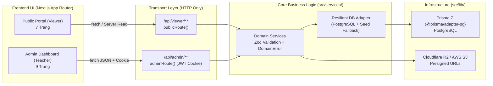

# KẾ HOẠCH TRIỂN KHAI BACKEND & ĐỒNG BỘ TÍCH HỢP FRONTEND (FULL-STACK INTEGRATION PLAN)

> **Dự án**: Classroom Management & Teacher Personal Branding Platform  
> **Kiến trúc mục tiêu**: Decoupled Service Architecture (Next.js 16.4.6 App Router + TypeScript + Prisma ORM 7 + PostgreSQL + Cloudflare R2/S3)  
> **Trạng thái hiện tại**: Toàn bộ 17 trang giao diện (7 trang Public Portal + 9 trang Admin Dashboard + 1 trang Login) và Design System đã hoàn thành 100%, vượt qua kiểm định `tsc`, `eslint` và `next build` (`26/26` routes).

---

## 1. Kiến trúc Kết nối Backend ↔ Frontend (Decoupled Flow)

Để đảm bảo tính bền vững 10 năm theo đúng kiến trúc đã khởi tạo:

> [!IMPORTANT]
> **Nguyên tắc Bất biến (Enforced by ESLint)**:
> 1. `src/app/api/**` **CHỈ** làm nhiệm vụ giải mã HTTP Request (`readJson`, `readQuery`), kiểm tra quyền (`adminRoute` / `publicRoute`) và trả về chuẩn `ApiResponse<T>` (`ok()` / `fail()`).
> 2. `src/services/**` chứa 100% logic nghiệp vụ, kiểm tra dữ liệu đầu vào bằng `zod` (`validate()`), tính toán điểm số/chuyên cần và gọi `prisma`. Tuyệt đối không import `next/*` trong `src/services/**`.

---

## 2. Lộ trình Triển khai 5 Giai đoạn (Backend + Frontend Wiring)

### Giai đoạn 1: Thiết kế Prisma Schema, Migration & Seed Dữ liệu (`src/prisma/schema.prisma`)

Hoàn thiện lược đồ cơ sở dữ liệu PostgreSQL trên Prisma 7 bao phủ toàn bộ 11 thực thể đang hiển thị trên Frontend:

| Nhóm Phân hệ | Model trong `schema.prisma` | Các trường & Quan hệ cốt lõi |
|---|---|---|
| **Cấu hình & Thương hiệu** | `TeacherSetting` | `id`, `name`, `title`, `credentials[]`, `slogan`, `shortBio`, `philosophy`, `officeHours`, `location`, `currentTerm`, `defaultPortalPin` |
| **Lớp học & Lịch dạy** | `Classroom`, `ClassSession`, `Enrollment` | Mã lớp (`II-01`), trình độ CEFR, sĩ số tối đa, học phần hiện tại, các ca dạy trong tuần (`dayOfWeek`, `startTime`, `endTime`, `room`, `topic`) |
| **Học sinh & Học vụ** | `Student`, `Assessment`, `GradeRecord`, `AttendanceRecord`, `TuitionRecord` | Mã HS (`HS-2026-01` `@unique`), `accessPinHash` (bcrypt), điểm 4 kỹ năng (`listening`, `reading`, `writing`, `speaking`, `overall`), điểm danh (`present`, `late`, `absent`, `excused`), học phí (`paid`, `due_soon`, `overdue`) |
| **CMS Thương hiệu** | `Announcement`, `AnnouncementAttachment`, `PodcastEpisode`, `HallOfFameEntry`, `StudentProject` | Bản tin (danh mục, ghim, nháp/xuất bản), Podcast (thời lượng, `audioKey`, `showNotes`, `vocabularyHighlights` JSON), Bảng vàng (`week`/`month`/`course`, hạng 1–5), Dự án học sinh |
| **Kho Lưu trữ Cloud** | `ResourceFolder`, `ResourceFile` | Cây thư mục (`parentId`), phân quyền `visibility` (`public` / `private`), `objectKey`, `fileType` (`PDF`, `SLIDE`, `WORKSHEET`, `AUDIO`), `sizeBytes`, `downloads` |

**Công việc thực thi ở Giai đoạn 1**:
1. Viết đầy đủ [src/prisma/schema.prisma](file:///d:/Project-My/english-manager-teacher/src/prisma/schema.prisma) với các `enum`, `@index` và ràng buộc khóa ngoại.
2. Chạy `npx prisma generate` để sinh bộ kiểu TypeScript vào `src/generated/prisma`.
3. Tạo script khởi tạo dữ liệu mẫu `src/prisma/seed.ts` nạp toàn bộ dữ liệu học thuật thực tế từ `classroom-data.ts` vào PostgreSQL.

---

### Giai đoạn 2: Nâng cấp Tầng Core Services (`src/services/*.service.ts`)

Hoàn thiện và mở rộng các Service để phục vụ cả truy vấn đọc (Viewer) và thao tác ghi/cập nhật (Admin):

| Tệp Service | Chức năng Nghiệp vụ Triển khai | Đồng bộ với Màn hình Frontend |
|---|---|---|
| `src/services/student.service.ts` | - `listStudents` (tìm kiếm, lọc theo lớp & học phí, sắp xếp, phân trang) - `getStudentById`, `createStudent`, `updateStudent`, `deleteStudent` - `verifyStudentPortal(code, accessPin)`: Xác thực Mã HS + Mật khẩu tra cứu, trả về hồ sơ học vụ cá nhân | - Admin: `/students` - Viewer: `/student` & `/student/[id]` |
| `src/services/classroom.service.ts` *(Mới)* | - `listClassrooms`, `createClassroom`, `updateClassroom`, `getClassroomRoster` | - Admin: `/classes` & `/dashboard` |
| `src/services/schedule.service.ts` | - `listWeeklySchedule` (kèm phát hiện xung đột trùng giờ `hasConflict`) - `createClassSession`, `recordAttendance` (bulk upsert 1 chạm cho cả lớp) | - Viewer: `/#weekly-schedule` - Admin: `/schedule` & `/attendance` |
| `src/services/grade.service.ts` *(Mới)* | - `listAssessments`, `createAssessment` - `listGradesByAssessment`, `batchRecordGrades` (tự động tính `overall = round((L+R+W+S)/4 * 2)/2`) | - Admin: `/grades` - Viewer: `/student` (sau xác thực) |
| `src/services/cms.service.ts` *(Mới)* & `podcast.service.ts` | - CRUD cho `Announcements` (kèm ghim & lưu nháp), `Podcasts`, `HallOfFame`, `StudentProjects` - `getHomepageFeed()`: Gom dữ liệu tối ưu cho Trang chủ | - Viewer: `/`, `/announcements`, `/hall-of-fame`, `/podcast`, `/showcase` - Admin: `/cms` |
| `src/services/storage.service.ts` | - Giữ nguyên luồng Presigned URL S3/R2 đã viết - Bổ sung `listFolders`, `listFiles`, `createFileRecord`, `toggleFileVisibility`, `deleteFileRecord` | - Viewer: `/documents` - Admin: `/storage` |
| `src/services/settings.service.ts` *(Mới)* | - `getSystemSettings`, `updateSystemSettings` (cập nhật hồ sơ thương hiệu giáo viên & cấu hình cổng) | - Viewer: `/` (Hero & Footer) - Admin: `/settings` |

> [!TIP]
> **Cơ chế Resilient Data Layer (Chạy mượt ngay cả khi chưa bật PostgreSQL local)**:
> Mỗi hàm trong `src/services/**` sẽ kết nối trực tiếp với Prisma/PostgreSQL, đồng thời tích hợp tầng **In-Memory Stateful Store** khởi tạo từ `classroom-data.ts` làm fallback tự động nếu `DATABASE_URL` chưa kết nối tới máy chủ Postgres. Nhờ đó, toàn bộ thao tác Thêm / Sửa / Xóa / Điểm danh / Nhập điểm trên UI đều gọi qua REST API thật (`/api/**`), được validate bằng `zod` và lưu trạng thái xuyên suốt phiên làm việc mà không bao giờ bị lỗi `500 Connection Refused`.

---

### Giai đoạn 3: Xây dựng Hệ thống RESTful API Routes (`src/app/api/**`)

Triển khai đầy đủ các Route Handlers mỏng (~15 dòng/tệp) sử dụng `publicRoute()` và `adminRoute()` từ [src/lib/http.ts](file:///d:/Project-My/english-manager-teacher/src/lib/http.ts):

#### A. Public / Viewer Endpoints (`src/app/api/viewer/**`)
1. `GET /api/viewer/overview` — Dữ liệu tổng hợp cho Trang chủ (`/`).
2. `GET /api/viewer/announcements` & `GET /api/viewer/announcements/[id]` — Danh sách & chi tiết thông báo.
3. `GET /api/viewer/hall-of-fame` — Bảng vàng lọc theo `period` (`week` | `month` | `course`).
4. `GET /api/viewer/podcasts` — Danh sách các tập Podcast đã xuất bản (`includeDrafts: false`).
5. `GET /api/viewer/showcase` — Danh sách dự án học sinh.
6. `GET /api/viewer/documents` — Danh mục thư mục & tài liệu `public`.
7. `POST /api/viewer/student-portal/verify` — Nhận `{ studentCode, accessKey }`, kiểm tra bảo mật tại `student.service` và chỉ trả về dữ liệu học vụ của đúng học sinh đó khi xác thực thành công (`401 UNAUTHORIZED` nếu sai mã hoặc mật khẩu).

#### B. Protected Admin Endpoints (`src/app/api/admin/**` — Bảo vệ bởi JWT Cookie `em_session`)
1. `GET /api/admin/dashboard` — KPI tổng hợp, lịch dạy hôm nay, cảnh báo học phí.
2. `GET, POST /api/admin/students` & `PATCH, DELETE /api/admin/students/[id]` — Quản lý hồ sơ học sinh.
3. `GET, POST /api/admin/classes` & `PATCH /api/admin/classes/[id]` — Quản lý lớp học.
4. `GET, POST /api/admin/schedule` — Quản lý ca dạy & kiểm tra trùng lịch.
5. `GET, POST /api/admin/attendance` — Lấy danh sách điểm danh ca học & lưu điểm danh hàng loạt (`recordAttendance`).
6. `GET, POST /api/admin/grades` — Tạo kỳ kiểm tra & lưu bảng điểm 4 kỹ năng hàng loạt (`batchRecordGrades`).
7. `GET, POST, PATCH, DELETE /api/admin/cms/[module]` — Quản trị nội dung tập trung cho `announcements`, `podcasts`, `hall-of-fame`, `projects`.
8. `GET, POST, PATCH, DELETE /api/admin/storage` & `POST /api/admin/storage/upload-url` — Quản lý tệp, đổi quyền `Public`/`Private` và cấp Presigned URL tải lên S3/R2.
9. `GET, PUT /api/admin/settings` — Đọc và lưu cài đặt thương hiệu giáo viên & hệ thống.

---

### Giai đoạn 4: Đồng bộ Hóa (Feat) API vào 16 Trang Frontend Đã Triển khai

Kết nối trực tiếp các trang UI hiện tại với hệ thống `/api/**` thông qua client helper thống nhất `src/lib/api-client.ts`:

1. **Cổng Tra cứu Học sinh ([student-portal-view.tsx](file:///d:/Project-My/english-manager-teacher/src/components/viewer/student-portal-view.tsx))**:
   - Thay thế lời gọi hàm cục bộ bằng `POST /api/viewer/student-portal/verify` với trạng thái `isSubmitting` trên nút bấm, xử lý lỗi `401` từ server và hiển thị dữ liệu thực tế từ API.
2. **Các trang Public Portal (`/`, `/announcements`, `/hall-of-fame`, `/podcast`, `/showcase`, `/documents`)**:
   - Đồng bộ dữ liệu từ `/api/viewer/**` để khi Giáo viên vừa đăng thông báo mới, thêm học sinh vào Bảng vàng, tải lên tài liệu hoặc đổi quyền file sang `Private` ở trang Admin, trang Public Portal sẽ phản ánh ngay lập tức!
3. **Các trang Admin Dashboard (`/dashboard`, `/students`, `/classes`, `/schedule`, `/attendance`, `/grades`, `/cms`, `/storage`, `/settings`)**:
   - Kết nối toàn bộ các biểu mẫu (Modal thêm/sửa học sinh, tạo lớp, thêm ca học, lưu điểm danh 1 chạm, lưu bảng điểm 4 kỹ năng, soạn thông báo Rich Text, đổi quyền file Public/Private, lưu cài đặt thương hiệu) tới các endpoint `/api/admin/**` tương ứng.
   - Hiển thị trạng thái `loading` khi gửi request, cập nhật state từ phản hồi `ApiSuccess<T>` và bật thông báo `useToast()` chuẩn xác.

---

### Giai đoạn 5: Kiểm định End-to-End (QA & Verification)

1. Chạy `npx prisma generate` để xác nhận Prisma Client khớp 100% với Schema.
2. Chạy `npx next typegen` & `npm run typecheck` (`0` lỗi TypeScript).
3. Chạy `npm run lint` (`0` lỗi, `0` cảnh báo ESLint, đảm bảo không vi phạm ranh giới `no-restricted-imports`).
4. Chạy `npm run build` để kiểm chứng toàn bộ các API Routes và Pages biên dịch sạch sẽ.
5. Lưu báo cáo tổng kết triển khai Backend & Full-stack Integration bằng tiếng Việt trong thư mục `reports/`.

